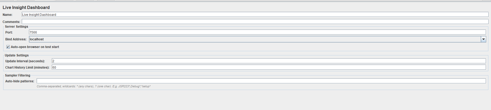
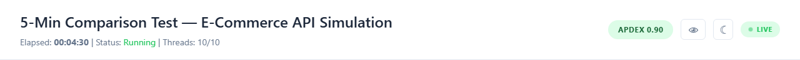
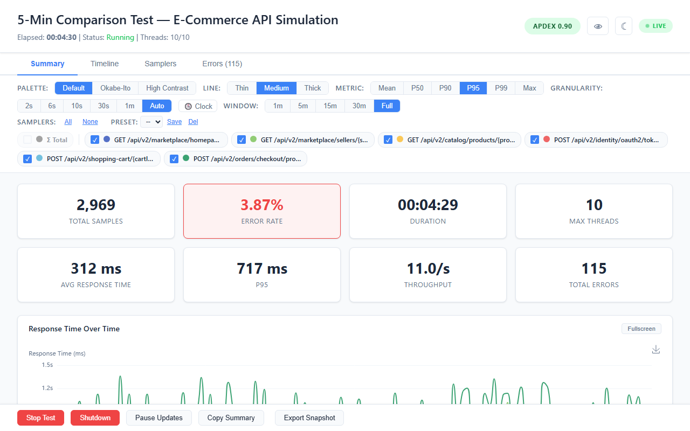
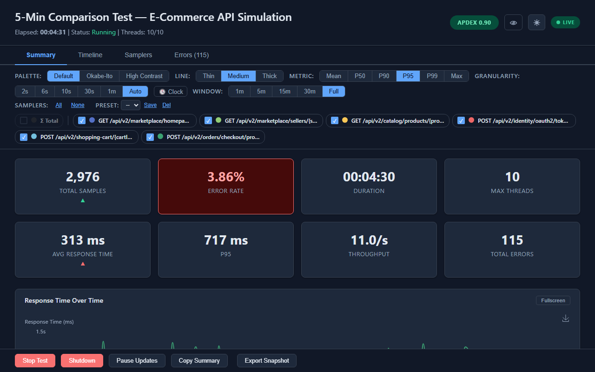
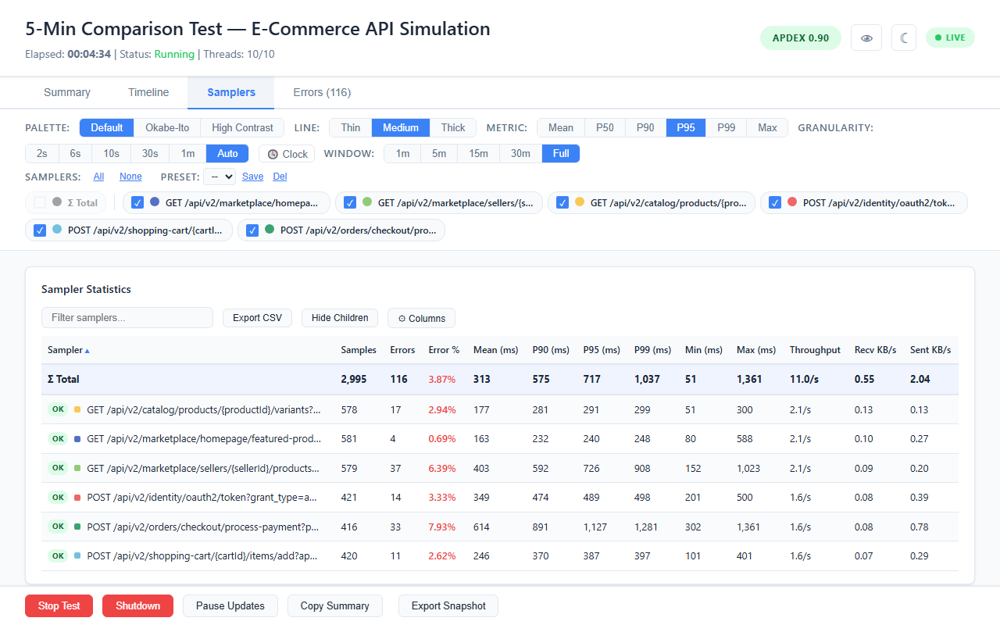
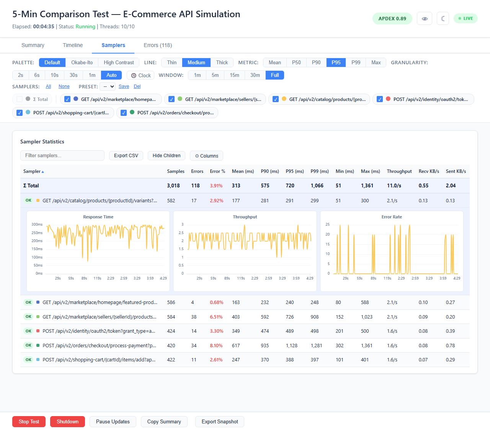
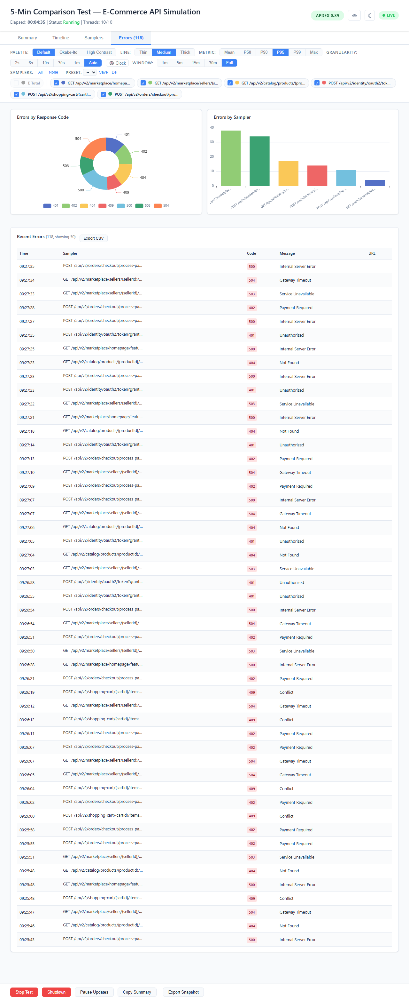
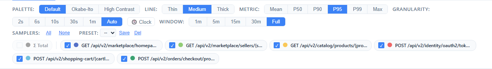

# Getting Started

## What Is Live Insight Dashboard?

Live Insight Dashboard is an **Apache JMeter plugin** that shows test metrics **live** in a browser, in GUI mode or from the command line. It needs no Grafana, no InfluxDB and no other external infrastructure.



**Key features:**

- **Zero setup** — drop the JAR into JMeter's `lib/ext/` folder and run. No external databases, no configuration files, no infrastructure.
- **Live streaming** — metrics reach the browser over Server-Sent Events (SSE) as the test runs, once per update interval: every 2 seconds by default, and 1 second at the fastest.
- **Works in GUI and CLI mode** — add the Live Insight Dashboard listener to your test plan; the same plan runs in GUI mode or non-GUI (CLI) mode.
- **Interactive charts** — zoom, pan, filter by sampler, sort tables, drag-reorder charts, fullscreen individual panels.
- **Error analysis** — a pie chart of errors by response code, a bar chart of errors by sampler, and a table of recent errors with sampler, code, message and URL.
- **SLA monitoring** — optional P95 and error rate thresholds: a reference line on the charts, PASS / WARN / FAIL badges, and a browser notification when a sampler fails.
- **Apdex scoring** — real-time application performance index, shown as a color-coded badge in the header.
- **Snapshot export** — download a self-contained HTML file with all the data and interactive charts. It opens without a server.
- **Dark mode and colorblind mode** — built-in, one-click toggle.
- **Post-test review** — the dashboard stays alive after the test ends so you can explore the results at your own pace.

The dashboard is a **single HTML page** served by an embedded HTTP server inside JMeter. Data streams via Server-Sent Events (SSE). When the test ends, the server stays alive for post-test review.

## Requirements

- Apache JMeter **5.6.3+**
- Java **11+**

## Installation

Download the plugin JAR from the [GitHub Releases page](https://github.com/aharon890/JmeterLiveInsightDashboard/releases) and copy it to JMeter's extension directory. Remove any older `jmeter-live-dashboard-*.jar` there first:

```bash
cp jmeter-live-dashboard-1.6.2.jar $JMETER_HOME/lib/ext/
```

No other dependencies. The JAR is self-contained.

### Build from Source

```bash
mvn clean package -DskipTests
cp target/jmeter-live-dashboard-1.6.2.jar $JMETER_HOME/lib/ext/
```

## Quick Start

### GUI Mode

1. Open JMeter
2. Add the listener: **Add > Listener > Live Insight Dashboard**
3. Configure settings in the listener panel (port, bind address, etc.)
4. Run the test
5. The dashboard opens automatically at `http://localhost:7566`

### CLI Mode (Non-GUI)

```bash
jmeter -n -t test.jmx
```

The test plan (`test.jmx`) must contain the Live Insight Dashboard listener — add it in the GUI and save the plan, then run that saved plan in non-GUI mode. The dashboard opens at `http://localhost:7566`.

**With custom settings:**

```bash
jmeter -n -t test.jmx \
  -Jlive.dashboard.port=8080 \
  -Jlive.dashboard.bind=0.0.0.0 \
  -Jlive.dashboard.update.interval=1
```

See [Configuration](10-Configuration.md) for all available properties.

## Dashboard Layout

The dashboard has 4 main areas:

### Header



Displays (left to right):
- **Test name** — from the JMeter test plan
- **Elapsed time** — live timer that freezes when the test ends
- **Test status** — Running, Stopping or Ended
- **Thread count** — active/max threads
- **SLA badge** — SLA PASS, WARN or FAIL, shown only when an SLA threshold is set
- **Apdex badge** — the Apdex score, colored by its value
- **Colorblind mode toggle** — eye icon
- **Dark mode toggle** — crescent/sun icon
- **Live indicator badge** — LIVE, ENDED, EXPLORING, DISCONNECTED, CONNECTING, or CLOSED

### Tab Navigation

Four tabs organize the dashboard:

| Tab | Purpose |
|-----|---------|
| **Summary** | At-a-glance metric cards with trends, response time chart |
| **Timeline** | 5 full time-series charts with zoom sync |
| **Samplers** | Statistics table with sorting, filtering, inline detail charts |
| **Errors** | Error breakdown charts and detail table |

#### Summary





#### Timeline


#### Samplers





#### Errors



### Filter Bar



A persistent bar below the tabs with two rows:
- **Row 1:** Palette, Line thickness, Metric, Granularity, Clock/Elapsed, Window
- **Row 2:** All/None toggles, Presets, sampler checkbox pills

These settings apply to the time-series charts on every tab. The sampler pills filter the time-series charts only: the Samplers table, the Errors tab and the summary cards always show every sampler. Palette, line thickness, sampler colors, Clock/Elapsed and presets are saved in localStorage; Metric, Granularity, Window and the sampler selection go back to their defaults when the page reloads.

### Footer


A fixed footer with test controls and export actions:
- Stop Test, Shutdown, Pause Updates
- Copy Summary, Export Snapshot

## Technology

| Component | Technology |
|-----------|-----------|
| Plugin | Java (JMeter listener) |
| Percentiles | Exact, computed as JMeter's Aggregate Report does (at most 0.1% low above 10 s) |
| Charts | Apache ECharts 5.5.0 |
| Communication | Server-Sent Events (SSE) |
| Output | Self-contained HTML dashboard |
| Persistence | localStorage (dark and colorblind mode, palette, line thickness, sampler colors, Clock/Elapsed, chart order, hidden columns, presets) |

## Design Scope & Limitations

Live Insight Dashboard is purpose-built for **local development and testing** — it gives you instant visibility into your JMeter test while you build, tune, and debug it on your own machine.

By design, the plugin runs an embedded HTTP server on the same machine that executes the test. This keeps setup to zero configuration but comes with trade-offs:

- **Runs inside the local JMeter process** — the dashboard server lives in the JMeter process that runs (or controls) the test. A distributed (`-R`) run is counted correctly across all engines, but the Stop and Shutdown buttons act on the local engine only.
- **Not a production monitoring tool** — it is meant for development-time insight, not for long-running CI pipelines or centralized team dashboards. For those use cases, tools like Grafana + InfluxDB are better suited.
- **Browser access is local** — by default the server binds to `localhost`. You can bind to `0.0.0.0` to allow access from other devices on the same network, but there is no authentication or encryption.
- **In-memory data** — all metrics are held in memory for the duration of the test. Very long tests with many samplers will consume more heap. The Chart History Limit (`live.dashboard.window.max`) sets how long the fine-grained chart slots are kept; the 1-minute slots and the totals cover the whole run.

These are intentional constraints that keep the plugin lightweight, dependency-free, and ready to use in seconds.
