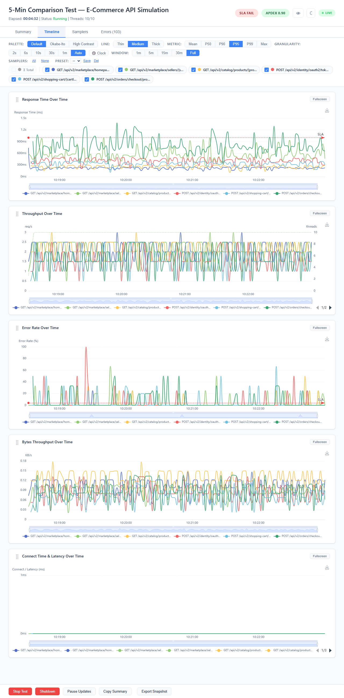
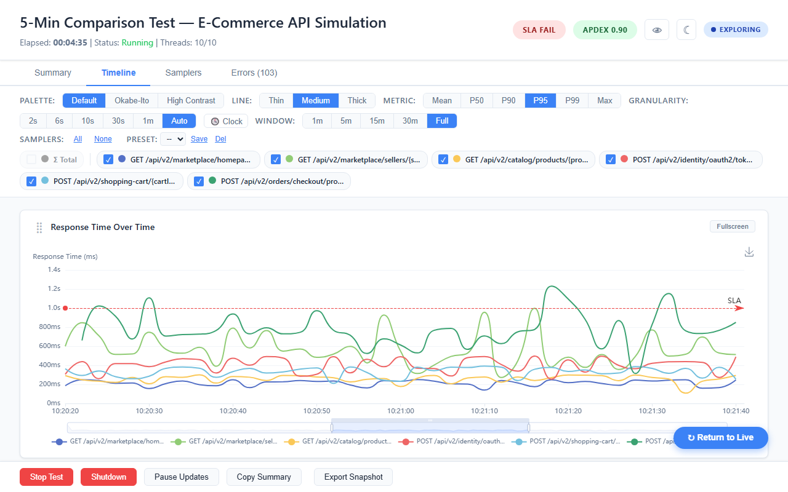
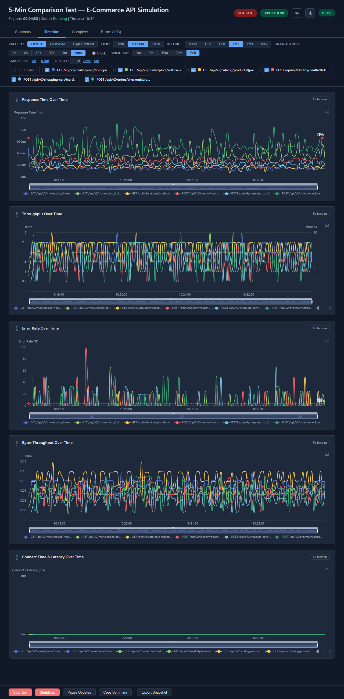

# Timeline Tab

Full time-series visualization of test metrics. All charts update in real-time as data streams from JMeter.

## Charts

Five charts are displayed in this default order:

### 1. Response Time Over Time

Per-sampler response time lines with the configurable metric (Mean, P50, P90, P95, P99, or Max). When the P95 SLA threshold is set (`live.dashboard.sla.default.p95`), a horizontal red dashed markline shows it while the metric is P95 or P99.

### 2. Throughput Over Time

Per-sampler throughput lines (req/s) on the primary Y-axis. An "Active Threads" dashed line on a secondary Y-axis shows thread ramp-up and ramp-down: the mean active threads per interval, as JMeter's HTML report computes it.

### 3. Error Rate Over Time

Per-sampler error rate percentage with semi-transparent area fill beneath each line. When SLA error rate thresholds are configured, a horizontal red dashed markline shows the SLA limit.

### 4. Bytes Throughput Over Time

Per-sampler received bytes per second, displayed in KB/s.

### 5. Connect Time and Latency Over Time

Per-sampler latency (solid lines) and connect time (dashed lines with reduced thickness), both in milliseconds. Uses the same color for both latency and connect of the same sampler.

## Chart Controls

Every chart has these controls:

| Control | Location | Behavior |
|---------|----------|----------|
| **Drag handle** | Left of title | Drag to reorder charts; order saved to localStorage |
| **Fullscreen** | Chart header | Expands chart to full viewport; header with Exit stays visible |
| **PNG export** | Chart toolbox (top-right) | Downloads chart as PNG at 2x pixel ratio |

## Drag-and-Drop Reorder

- Grab the grip handle (left of the chart title) and drag to a new position
- Drop to reorder — the chart settles into its new slot
- Chart order persists in localStorage across page reloads

## Chart Interactions

All charts support these interactions via ECharts:

| Interaction | How | Effect |
|-------------|-----|--------|
| **Hover tooltip** | Mouse over data point | Shows exact values with sampler name and color dots |
| **Zoom and pan** | Mouse wheel to zoom, drag inside the chart to pan | Changes the visible time range |
| **Time range slider** | Drag handles at bottom | Adjusts visible time range |
| **Legend toggle** | Click legend item | Shows/hides that series |
| **Cross-chart sync** | Hover/zoom any chart | All 5 Timeline charts follow via `echarts.connect()` |

### Zoom and Explore Mode

When you zoom into any chart, the dashboard enters **Explore mode**:
- All charts freeze at your zoom position
- Incoming data continues accumulating in memory
- The header badge changes from "LIVE" to "EXPLORING" (blue)
- A floating "Return to Live" button appears at the bottom-right
- Click the button to snap back to the latest data

See [Live Features](08-Live-Features.md) for details on the LIVE/EXPLORING states.

### Smart Y-Axis Formatting

Each label on a response time axis picks its unit from its own value:
- < 1,000 ms — milliseconds (ms)
- >= 1,000 ms — seconds (s)
- >= 60,000 ms — minutes (m on the axis, min in tooltips)

Tooltips show human-readable durations.

### Legend Truncation

Sampler names in chart legends are capped at 30 characters with hover tooltip for the full name.

### Smooth Lines and Null Handling

All chart series use smooth interpolation. The `connectNulls` option bridges gaps in sparse data from Open Model Thread Groups.

## Metric Toggle Impact

Changing the **Metric** toggle in the filter bar (Mean/P50/P90/P95/P99/Max) affects:
- Chart 1 (Response Time Over Time)
- The Summary tab response time chart
- Per-sampler detail charts in the Samplers tab

Other charts (Throughput, Error Rate, Bytes, Connect/Latency) are unaffected.

## Granularity Impact

Changing **Granularity** in the filter bar affects all Timeline charts, the Summary tab's Response Time chart, and the per-sampler charts in the Samplers tab:

| Option | One point per |
|--------|---------------|
| 2s | Update: the raw data (finest) |
| 6s | 6 s of clock time |
| 10s | 10 s of clock time |
| 30s | 30 s of clock time |
| 1m | Minute of clock time (coarsest) |
| Auto | Period chosen from the number of points in the window |

The labels are for the default 2 s update interval; each button shows the time it gives at the run's actual interval.

A point is a fixed period of clock time, as in JMeter's own report graphs, so a point already drawn does not change while the window slides. Rates, means, error % and max are exact for the period; a rate is the period's samples over its length, as JMeter's report divides. Percentiles are exact at 1m for each closed minute, where the chart uses the server's per-minute values; at 6s, 10s and 30s, and for the minute still open, they are an average of the 2 s values.

Higher granularity = smoother lines, fewer data points, better performance for long tests. Granularity changes only what is drawn; the stored data stays as it is (2 s for the last `live.dashboard.window.max`, 1 minute before that).

## Window Impact

The [Window selector](06-Filter-Bar.md) controls how much time-series data is visible:

| Option | Visible Data |
|--------|-------------|
| 1m | Last 60 seconds |
| 5m | Last 5 minutes |
| 15m | Last 15 minutes |
| 30m | Last 30 minutes |
| Full | All data since test start (default) |

The window only changes what is drawn, so switching back to Full loses nothing. Metric cards and the Samplers table always show full-test cumulative values.

## Dark Mode

Chart text colors, axis lines and grid lines adapt automatically when dark mode is toggled. The chart tooltips are dark in both modes. See [Dark Mode](07-Dark-Mode-Accessibility.md).

## Tips

- Use the **Full** window for short tests (< 10 min) and a shorter window for long-running tests to keep charts responsive.
- Drag-reorder to put the chart you care about most at the top.
- Use fullscreen mode during presentations or screen sharing.
- Cross-chart zoom sync lets you investigate a specific time window across all metrics simultaneously.
