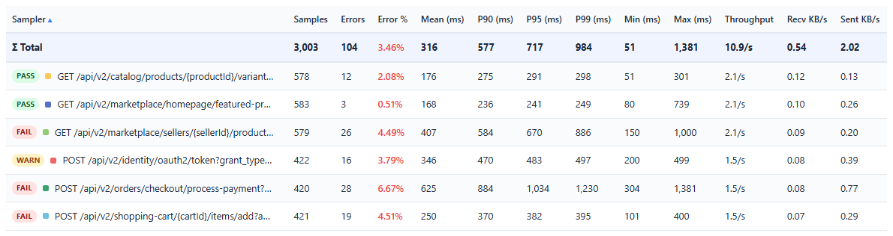
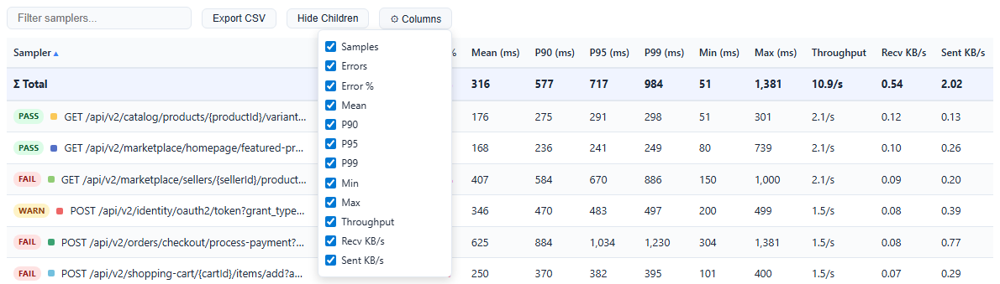
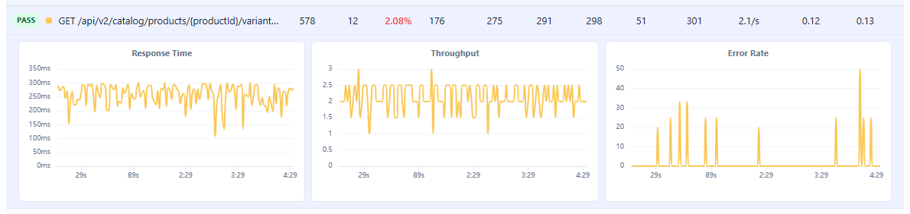
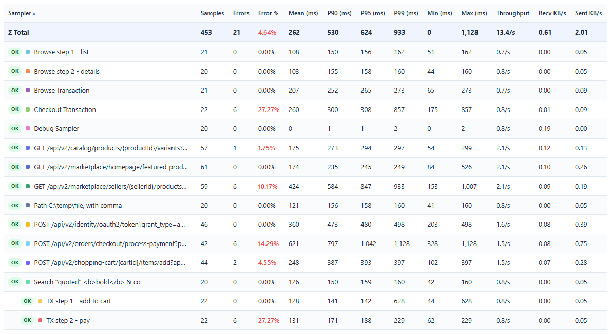

# Samplers Tab

Detailed per-sampler statistics table with sorting, filtering, column control, and inline chart expansion. All values update in real-time.

## Statistics Table

### Columns (13 total)

| Column | Description | Format |
|--------|-------------|--------|
| **Sampler** | Request label with color dot and SLA badge | Text (truncated at 350px, hover for full name) |
| **Samples** | Total request count | Integer with comma separator |
| **Errors** | Failed request count | Integer |
| **Error %** | Error rate | Percentage (e.g., "4.05%") |
| **Mean (ms)** | Average response time | Whole ms with comma separator (e.g., "1,077"), truncated as JMeter's Aggregate Report shows it |
| **P90 (ms)** | 90th percentile | Whole ms with comma separator |
| **P95 (ms)** | 95th percentile | Whole ms with comma separator |
| **P99 (ms)** | 99th percentile | Whole ms with comma separator |
| **Min (ms)** | Minimum response time | Whole ms with comma separator |
| **Max (ms)** | Maximum response time | Whole ms with comma separator |
| **Throughput** | Requests per second | One decimal (e.g., "15.2/s") |
| **Recv KB/s** | Received kilobytes per second | Two decimals (e.g., "12.34") |
| **Sent KB/s** | Sent kilobytes per second | Two decimals |

**Cumulative statistics:** The table always shows full-test cumulative values, not windowed data. This ensures consistent reporting regardless of the selected time window.

### Sigma Total Row

A synthetic aggregate row pinned at the top of the table with bold styling. Its values are not computed from the rows below. They are the server's statistics over all top-level samples, as JMeter's Aggregate Report computes its TOTAL row. Transaction children are not counted twice.

| Metric Type | Calculation |
|-------------|-------------|
| Samples, Errors | Counted over all top-level samples |
| Mean | Mean of all top-level samples |
| P90, P95, P99 | Exact percentile of all top-level samples (not an average of the samplers' percentiles) |
| Min, Max | Overall minimum and maximum |
| Error % | Total errors / total samples |
| Throughput, Recv KB/s, Sent KB/s | Totals divided by the run's duration |

### SLA Badges

Each sampler row shows an inline badge:

| Badge | Condition |
|-------|-----------|
| **OK** (green) | No SLA configured |
| **PASS** (green) | All metrics under 80% of threshold |
| **WARN** (amber) | At least one metric between 80% and 100% of threshold |
| **FAIL** (red) | At least one metric exceeds threshold |

### Color Dots

Each sampler row includes a colored square matching its chart series color, providing visual correlation between the table and charts.

## Table Interactions

### Sorting

- Click any **column header** to sort ascending
- Click the **same header again** to sort descending
- Visual indicator (triangle) appears on the sorted column

### Search / Filter

- A text input above the table filters rows by sampler name
- Matching is case-insensitive
- Non-matching rows are hidden (not removed)
- Clear the input to restore all rows

### Column Visibility

- Click the **"Columns"** button to open a dropdown
- The 12 data columns are listed with checkboxes; the Sampler column is always shown
- Uncheck a column to hide it from the header and all data rows
- Re-check to restore it in its original position
- State persists in localStorage

### CSV Export

- Click the **"Export CSV"** button to download `live-samplers_<timestamp>.csv`
- Exports every sampler and all 13 columns, including rows and columns hidden in the table. The Σ Total row is not included
- CSV uses UTF-8 encoding with quoted fields

## Per-Sampler Detail Expansion

Click any sampler row to expand an inline detail panel with **3 mini-charts**.

### Expand/Collapse

- **Click row** — detail panel appears below the row
- **Click row again** — panel collapses

### Chart Slots

The detail panel has 3 chart slots:

| Slot | Chart | Description |
|------|-------|-------------|
| 1 | Response Time | Per-sampler response time using the selected metric |
| 2 | Throughput | Per-sampler throughput over time |
| 3 | Error Rate | Per-sampler error rate with area fill |

### Behavior

- Charts update in real-time alongside the main charts
- Any number of samplers can be expanded at once
- Charts are arranged in a 3-column grid below the sampler row
- Mini-chart time labels count from the start of the test (30s, 2:15); after two hours they switch to the main charts' Clock/Elapsed format
- Zooming one mini-chart zooms all of them (every expanded sampler, all three KPIs); the zoom is not reset by live data updates, and the mini-charts hold still until you zoom back out to the whole run

## Transaction Controller Hierarchy

Parent and child rows come from JMeter's own results, not from sampler names.

### Default Behavior

- Both parent transactions and child samplers are shown
- Child samplers appear with left padding (24px indent)
- Child rows include a tooltip indicating the parent name

### Show/Hide Children Toggle

- A **"Show Children" / "Hide Children"** button in the Samplers toolbar
- When hidden, child samplers are removed from the table
- When shown, children appear indented, in the table's sort order like any other row (they are not grouped under their parent)

### Detection

When a sample carries sub-results, as a Transaction Controller with "Generate parent sample" produces, each sub-result is shown as a child of that sample. Sampler names play no part: two samplers named `"Login Flow"` and `"Login Flow-Authenticate"` are not related unless one is a sub-result of the other.

## Name Truncation

Long sampler names are truncated with ellipsis at 350px width. The full name appears in a hover tooltip.

## Tips

- Use the search filter to focus on specific samplers during complex tests with many endpoints.
- Expand the 2-3 most critical samplers to watch their individual trends while the test runs.
- Column toggle is useful for presentations — hide technical columns and show only what matters.
- The Sigma Total row provides a quick overall health check — if the total P95 is climbing, something is degrading.
