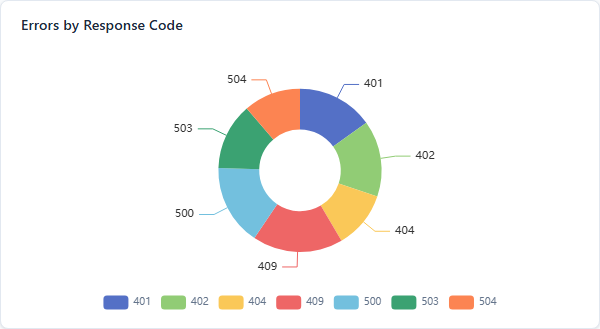
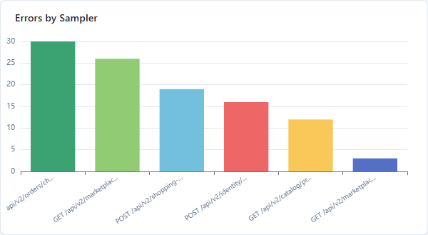

# Errors Tab

Error breakdown charts and detail table for investigating test failures.

## Error Charts

Two charts displayed side by side:

### Errors by Response Code (Pie/Donut)

- Donut chart showing error distribution by HTTP status code
- Labels shown when 8 or fewer unique codes exist
- Hover tooltip shows count and percentage

### Errors by Sampler (Bar Chart)

- Vertical bar chart showing the top 15 samplers by error count
- Per-sampler colors matching the filter bar color dots
- Sorted by count descending
- Sampler names truncated at 25 characters in axis labels

### Chart Controls

The error charts have no Fullscreen button. Hover a slice or bar to see its count.

Charts refresh automatically when switching to the Errors tab.

## Error Details Table

A table of individual error records:

| Column | Description |
|--------|-------------|
| **Time** | Timestamp of the error |
| **Sampler** | Request label (truncated at 250px, hover for full name) |
| **Code** | HTTP response code with colored badge |
| **Message** | Response message text (truncated at 60 characters) |
| **URL** | The request URL that failed (truncated at 60 characters) |

### Error Count Display

The error count appears in two places:
- The section header above the table
- The Errors tab label (e.g., "Errors (42)")

### Error Sampling

The server retains up to **100 recent error samples** (configurable via `-Jlive.dashboard.error.samples.max=100`). The table displays up to 50 at a time.

### CSV Export

Click **"Export CSV"** to download `live-errors_<timestamp>.csv` with 5 columns (Time, Sampler, Code, Message, URL). It holds the error records the server keeps (up to 100 by default), not every error of the run. Uses UTF-8 encoding with quoted fields.

## Sampler Filter Integration

The sampler pills in the filter bar do not apply to this tab. Both charts and the table always include every sampler's errors, whichever pills are checked.

## Edge Cases

| Scenario | Behavior |
|----------|----------|
| Zero errors | Tab shows empty charts and empty table — no layout issues |
| 100% errors | All charts render normally, all table rows show error data |
| Many error codes | Pie chart labels hidden when > 8 unique codes; hover for values |

## Tips

- The pie chart quickly reveals which HTTP status codes dominate — 500s vs 404s vs 503s tell different stories.
- The bar chart identifies which samplers fail most, helping prioritize investigation.
- To look at one endpoint's errors, export the CSV and filter it by the Sampler column.
- Export the error CSV for sharing with developers who need the raw error data.
