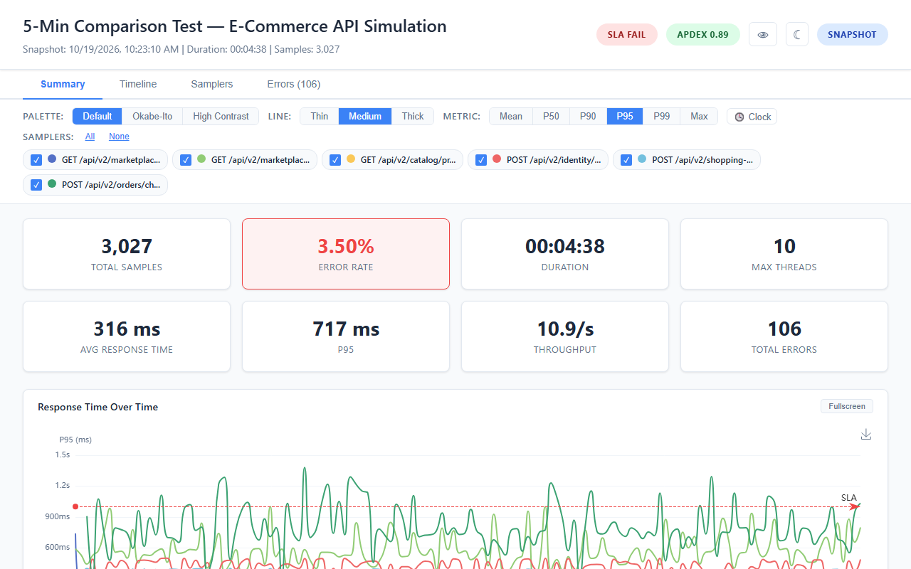
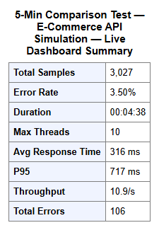
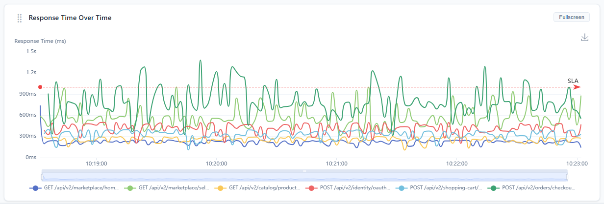

# Export & Snapshot

## Export Snapshot HTML

The **"Export Snapshot"** button in the footer downloads a self-contained HTML file with all current dashboard data embedded as JSON.

### What's Included

- All 4 tabs: Summary, Timeline, Samplers, Errors
- Fully interactive charts (zoom, pan, legend toggle) via embedded ECharts
- Sampler statistics table and error table fully rendered
- Current dark mode setting preserved
- Filter state (palette, line thickness, metric selection)
- All cumulative data at the time of export

### What's Not Included

- Live SSE connection (snapshot is static)
- Test controls (Stop/Pause buttons)
- Future data (snapshot captures the moment of export)
- Window and Granularity selectors: the snapshot draws every stored point (the 2-second slots of the last `live.dashboard.window.max`, 1-minute points before that)
- The Σ Total pill, filter presets, the Columns menu and Show/Hide Children
- Per-sampler detail charts and the trend arrows on the metric cards

The snapshot's error table lists up to 100 error records (all the server keeps at the default `live.dashboard.error.samples.max`); the live table shows 50.

### File Details

| Property | Value |
|----------|-------|
| Format | Self-contained HTML |
| Dependencies | None — works offline, no server needed |
| Filename | `live-dashboard-snapshot_2026-03-31T14-30-50.html` (timestamp included) |
| Size | Typically 1-5 MB depending on data volume |

### Use Cases

- Share test results with team members who don't have JMeter access
- Archive test results for later review
- Attach to bug reports or performance review documents
- Compare snapshots from different test runs side by side

## Copy Summary as HTML

The **"Copy Summary"** button in the footer copies an HTML table to the clipboard containing all 8 metric card values.

### Clipboard Contents

Two representations are written to the clipboard:

| Format | Content |
|--------|---------|
| `text/html` | Formatted table with the test name as caption |
| `text/plain` | Simple key-value pairs as plain text |

### Paste Targets

The HTML table is formatted for direct pasting into:
- Confluence pages
- SharePoint documents
- Email reports (Outlook, Gmail)
- Wiki pages
- Google Docs

## CSV Export

Two CSV export buttons are available:

### Sampler Statistics CSV

- **Location:** Samplers tab toolbar
- **Filename:** `live-samplers_<timestamp>.csv` (`snapshot-samplers_<timestamp>.csv` from a snapshot)
- **Columns:** All 13 columns (Sampler, Samples, Errors, Error %, Mean, P90, P95, P99, Min, Max, Throughput, Recv KB/s, Sent KB/s)
- **Scope:** All samplers including hidden rows and columns. The Σ Total row is not included

### Error Details CSV

- **Location:** Errors tab toolbar
- **Filename:** `live-errors_<timestamp>.csv` (`snapshot-errors_<timestamp>.csv` from a snapshot)
- **Columns:** 5 columns (Time, Sampler, Code, Message, URL)
- **Scope:** The error records the server keeps: the latest `live.dashboard.error.samples.max` (default 100), including those past the 50 the table shows

### CSV Format

- UTF-8 encoding
- Quoted fields with escaped double quotes
- Header row included
- The error CSV's Time column and the timestamp in every export file name are UTC (e.g. `2026-03-31T12:30:50.123Z`); the Errors tab shows local time (or elapsed time, with the Elapsed toggle)

## PNG Chart Export

The Summary response time chart and the five Timeline charts include a **save-as-image button** (download icon) in the ECharts toolbox, at the top right of the chart.

| Property | Value |
|----------|-------|
| Format | PNG |
| Resolution | 2x pixel ratio (retina quality) |
| Scope | The individual chart, including legend and axis labels |

Available on all Timeline charts and the Summary response time chart, in the live dashboard and in a snapshot. The error charts and the per-sampler mini-charts have no PNG export.

## Tips

- Export a snapshot **before** stopping the test — this captures the live data at its most complete.
- The snapshot HTML works on any machine with a modern browser — no JMeter or server required.
- Use Copy Summary for quick status updates in team communication channels.
- CSV exports include hidden data, so you can hide columns in the UI for presentation while still exporting complete data.
