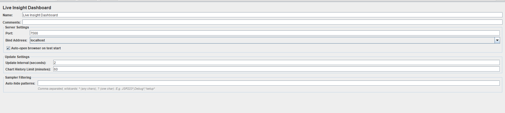

# Configuration

Six settings have fields in the JMeter GUI listener panel (table below). Every setting can be set as a `-J` command-line property.

## JMeter GUI Settings

When the Live Insight Dashboard listener is added to a test plan, the listener panel exposes these settings:



| Setting | Default | Description |
|---------|---------|-------------|
| **Port** | 7566 | HTTP server port. Auto-increments to next available port (up to 7575) if busy |
| **Bind Address** | localhost | Network interface. Use `0.0.0.0` for remote access, or type the address of one interface |
| **Auto-open browser** | true | Automatically open the dashboard in the default browser when the test starts |
| **Update Interval** | 2 (seconds) | How often data is pushed to the browser. Minimum 1 |
| **Chart History Limit** | 60 (minutes) | How long the 2-second chart slots are kept. Older parts of the run are still charted from 1-minute slots. Minimum 1 |
| **Auto-hide patterns** | `JSR223*,Debug*,BeanShell*` | Comma-separated wildcard patterns for samplers hidden by default: `*` any characters, `?` exactly one, everything else literal |

## CLI Properties

All properties use the `-J` flag on the JMeter command line or can be set in `jmeter.properties`.

### Activation

| Property | Default | Description |
|----------|---------|-------------|
| `live.dashboard.enabled` | `true` | Enable or disable the dashboard listener entirely |

**Note:** The dashboard starts only when the **Live Insight Dashboard** listener is present in the test plan. In GUI mode, add it via **Add > Listener > Live Insight Dashboard**. In CLI/non-GUI mode, make sure the listener is already saved in the `.jmx` before running. The `-J` properties below configure that listener; they do not activate the dashboard on their own.

### Server

| Property | Default | Description |
|----------|---------|-------------|
| `live.dashboard.port` | `7566` | HTTP server port |
| `live.dashboard.bind` | `localhost` | Bind address (`localhost` for local only, `0.0.0.0` for all interfaces) |
| `live.dashboard.open.browser` | `true` | Auto-open browser on test start |
| `live.dashboard.access.token` | *(not set)* | Meant for a dashboard bound beyond `localhost`. `generate` makes an access link for this JMeter start and prints it on the start line of `jmeter.log`. A token of your own (16 to 128 letters, digits, `-`, `_`, `.`, `~`) gives several runs one link. Once set, the link is asked for on every bind, `localhost` included. `not_required` says an open dashboard is intended. Not set: open, with a warning at start when the bind is beyond `localhost`. A `-J` property only; it is never saved in a plan. See "Example: Team Sharing" |

**Port auto-detection:** If port 7566 is in use, the server tries 7567, 7568, ..., up to 7575. This enables running multiple JMeter instances simultaneously.

### Data

| Property | Default | Description |
|----------|---------|-------------|
| `live.dashboard.update.interval` | `2` | Data push interval in seconds, `1` or more. A value of `1000` or more is read as milliseconds, the unit older versions used |
| `live.dashboard.window.max` | `3600` | Retention of the 2-second slots, in seconds (1 hour). The 1-minute slots cover the whole run regardless. Values below `60` are raised to `60`; `0` or less is ignored |

### Sampler Filtering

| Property | Default | Description |
|----------|---------|-------------|
| `live.dashboard.hide.patterns` | `JSR223*,Debug*,BeanShell*` | Comma-separated glob patterns for samplers unchecked by default |

### SLA and Apdex

| Property | Default | Description |
|----------|---------|-------------|
| `live.dashboard.sla.default.p95` | `-1` | P95 threshold in ms (`-1` = disabled) |
| `live.dashboard.sla.default.errorRate` | `-1` | Error rate threshold as % (`-1` = disabled) |
| `live.dashboard.apdex.threshold` | JMeter's `apdex_satisfied_threshold` (`500`) | Apdex T in milliseconds. F is always JMeter's `jmeter.reportgenerator.apdex_tolerated_threshold` (`1500`) |

Set SLA properties to `-1` to disable. When both are disabled, the header SLA badge is hidden and every row in the Samplers table shows OK.

### Error Sampling

| Property | Default | Description |
|----------|---------|-------------|
| `live.dashboard.error.samples.max` | `100` | Maximum number of recent error samples retained |

### Idle Timeout

| Property | Default | Description |
|----------|---------|-------------|
| `live.dashboard.idle.timeout` | `600` | Seconds the server stays up after the test has ended with no browser connected. Set to `0` to disable |

## Example: Minimal CLI

```bash
jmeter -n -t test.jmx
```

`test.jmx` must already contain the Live Insight Dashboard listener. Dashboard opens at `http://localhost:7566` with all defaults.

## Example: Full Configuration

```bash
jmeter -n -t test.jmx \
  -Jlive.dashboard.port=8080 \
  -Jlive.dashboard.bind=0.0.0.0 \
  -Jlive.dashboard.update.interval=1 \
  -Jlive.dashboard.window.max=7200 \
  -Jlive.dashboard.sla.default.p95=2000 \
  -Jlive.dashboard.sla.default.errorRate=5 \
  -Jlive.dashboard.apdex.threshold=300 \
  -Jlive.dashboard.hide.patterns="JSR223*,Debug*,BeanShell*,Setup*" \
  -Jlive.dashboard.error.samples.max=200 \
  -Jlive.dashboard.idle.timeout=1800
```

A plan saved from the JMeter GUI always holds Port, Update Interval, Chart History Limit and Auto-hide patterns, so set those four in the listener panel; Port and Auto-hide patterns can instead be cleared there to hand them to `-J`.

This configures:
- Remote access from other machines
- Port 8080 *(only if the plan doesn't already set it; see Property Precedence below)*
- 1-second update interval *(only if the plan doesn't already set it; see Property Precedence below)*
- 2 hours of 1-second chart detail (the whole run is kept at 1-minute resolution either way) *(only if the plan doesn't already set it; see Property Precedence below)*
- SLA: P95 under 2 seconds, error rate under 5%
- Apdex threshold at 300ms
- Hide utility samplers + setup samplers *(only if the plan doesn't already set it; see Property Precedence below)*
- Retain 200 error samples
- 30-minute idle timeout

## Example: Team Sharing

```bash
jmeter -n -t test.jmx \
  -Jlive.dashboard.bind=0.0.0.0 \
  -Jlive.dashboard.access.token=generate \
  -Jlive.dashboard.open.browser=false
```

Binds to all interfaces so team members can open the dashboard from their own machines. Disables auto-open since the test runner may be headless.

**The access link.** With `live.dashboard.access.token=generate`, the start line of `jmeter.log` prints the dashboard's address with a token at its end:

```
Live Dashboard <version> started: http://localhost:7566/?token=3f9c...e1
```

Send teammates that link with your machine's name or address in place of `localhost` (`http://<your-ip>:7566/?token=3f9c...e1`). What they see:

- **With the link:** the dashboard. Opened once, their browser remembers it, and the plain address `http://<your-ip>:7566` works from then on in that browser.
- **Without the link:** the answer "This dashboard needs its access link". They cannot read the run or stop it.
- **A script** (curl, a pipeline) sends the token in a header: `curl -H "Authorization: token 3f9c...e1" http://<your-ip>:7566/api/status`.

Each JMeter start makes a new token; runs started one after another in the same JMeter window keep it. To keep one link over several JMeter starts, for example a script that runs plans one after another on the same port, give every run the same token of your own: `-Jlive.dashboard.access.token=<16 to 128 letters, digits, - _ . ~>`. A token of your own is written to every run's `jmeter.log`, on the start line: whoever can read the log of one run has the link for every run that reuses the token.

A token that is set is asked for on every bind, `localhost` included: a dashboard on `localhost` behind a reverse proxy, an SSH tunnel or a port-forward is reached from other machines too. Without the property nothing changes on `localhost`. The token keeps out people who can reach the port; it is not encryption, so it does not protect against someone who can read the network traffic.

Without the property a dashboard bound beyond `localhost` is open to anyone who can reach its port, and `jmeter.log` says so at start. `-Jlive.dashboard.access.token=not_required` states that this is intended and silences the warning.

**In a pipeline.** An empty value counts as not set, because JMeter itself drops a property given as `-Jname=`. So `-Jlive.dashboard.access.token="$DASHBOARD_TOKEN"` with the variable unset starts an open dashboard. Write `-Jlive.dashboard.access.token="${DASHBOARD_TOKEN:-generate}"` to fall back to a generated link.

**Several dashboards on one machine.** The browser remembers each link under the port of the address you opened, so two JMeter containers published on ports 7566 and 7567 keep their own links, and so do two tunnels.

## Example: CI/CD Pipeline

```bash
jmeter -n -t test.jmx \
  -Jlive.dashboard.open.browser=false \
  -Jlive.dashboard.idle.timeout=60 \
  -Jlive.dashboard.sla.default.p95=1000 \
  -Jlive.dashboard.sla.default.errorRate=2
```

No browser auto-open (headless CI). Short idle timeout. SLA thresholds for monitoring.

## Property Precedence

The listener element's own value wins, and `-J` is the **fallback** — not the other way
round. A value saved in the `.jmx` (whether typed into the GUI panel or edited by hand)
cannot be overridden from the command line:

1. GUI listener panel / saved `.jmx` element value (highest priority)
2. `-J` command-line properties
3. `jmeter.properties` file
4. Built-in defaults (lowest priority)

**`live.dashboard.open.browser` and `live.dashboard.bind` are the deliberate exceptions** —
for those two, `-J` beats the saved element value. Both describe the *machine* rather than
the test, and the GUI writes both into every plan it saves (the Bind Address box comes
pre-filled with `localhost`), so a headless or shared machine has to be able
to override them without rewriting the `.jmx`. All of this is pinned by tests; the
asymmetry is intentional.

The Port field is a text box, so clearing it hands control back to `-J` — it keeps the
normal rule and needs no exception.

**Two settings have no element value at all** and are configured only by property, so `-J`
always works for them: `live.dashboard.enabled` and `live.dashboard.error.samples.max`.

Practical consequence: if a `-J` property appears to be ignored, check whether the value
is saved in the element. Clear the Port or Auto-hide patterns field in the GUI (or remove
the property from the `.jmx`) and the `-J` value takes effect. An emptied Update Interval
or Chart History Limit field is not saved, so the plan keeps its old value: set the value
in the panel, or remove the property from the `.jmx`.

## Tips

- Add the Live Insight Dashboard listener to your test plan, then tune behavior with `-J` properties per run — but only for settings the plan has **not** already pinned. A value saved in the element wins over `-J` (see Property Precedence above). Clearing the Port or Auto-hide patterns field hands control back to `-J`; an emptied Update Interval or Chart History Limit field is not saved.
- **`live.dashboard.bind` and `live.dashboard.open.browser` can always be driven by `-J`.** Both describe the machine rather than the test, and the GUI writes both into every plan it saves, so for these two the `-J` value wins over the saved element value. `-Jlive.dashboard.bind=0.0.0.0` makes the dashboard reachable from other machines regardless of what the plan has saved.
- Set `bind=0.0.0.0` to share the dashboard with team members on the same network, and add `live.dashboard.access.token=generate` so that only someone with the link from `jmeter.log` can read the run and stop it. Without it there is no login: anyone who can reach that port can do both.
- On the default `localhost` bind the dashboard answers only to `localhost`, `127.0.0.1` and `[::1]`, on any port, so an SSH tunnel works. Any other host name gets a 403; a reverse proxy in front of it has to send `Host: localhost`.
- Lower the update interval to 1 second for more responsive charts during short tests.
- Increase `window.max` to keep 2-second detail for more than the last hour. Older parts of the run are charted at 1-minute resolution either way.
- Set `idle.timeout=0` if you want the server to stay alive indefinitely after the test ends.
